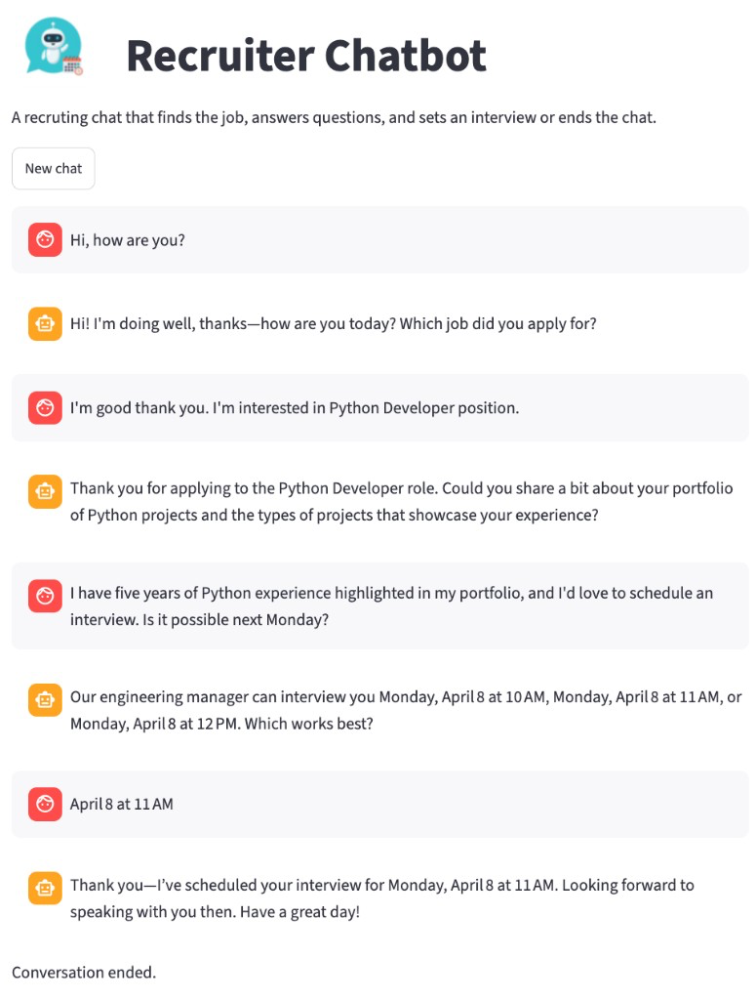

<!-- PROJECT LOGO -->
<p align="center">
  
</p>

<h1 align="center">Recruiter Chatbot</h1>

<p align="center">
  Automated assistant that screens candidates, answers role-specific questions, and schedules interviews<br>
</p>

---
<br></br>

## Table of Contents

- [About The Project](#about-the-project)
- [Features](#features)
- [Getting Started](#getting-started)
- [Screenshots](#screenshots)
- [Code Examples](#code-examples)
- [Project Structure](#project-structure)
- [Contact](#contact)
- [Acknowledgments](#acknowledgments)

---
<br></br>


## About The Project

> This project demonstrates a simple recruiting chat. It talks to a candidate using an LLM and identifies the candidate's desired role. The chat then extracts the information on that role and asks the candidate questions. It also answers the candidate's questions on that specific role. The chat can schedule an interview or end the chat. For an interview it offers three times from the SQL calendar.
>
> The Exit Advisor is the Hugging Face model `gilsagie/qwen-exit-advisor`, a LoRA merge on `Qwen/Qwen2.5-0.5B-Instruct`. It decides whether the conversation should end.

> An Info Needed turn queries the Chroma store at `data/chroma_job_description` and answers from the two closest passages.

<br>

<div style="background: #272822; color: #f8f8f2; padding: 10px; border-radius: 8px;">
  <b> Technologies:</b> Python, Streamlit, LangChain, OpenAI API, Hugging Face, SQL Server, pypdf, Chroma
</div>

---
<br></br>


## Features

- [x] Streamlit chat
- [x] Main agent chooses continue, schedule, or end
- [x] Exit, scheduling, and info advisors
- [x] Job title taken from the chat, then that job's PDF
- [x] Three interview slots from the SQL calendar
- [x] Info answers from the text of that job
- [x] Chroma lookup on Info Needed
- [ ] Streamlit Community Cloud

---
<br></br>


##  Getting Started

### Prerequisites

- Python >= 3.12
- pip
- Docker Desktop on a Mac. Windows uses SQL Server Express and does not use Docker.

### Installation


```bash
git clone https://github.com/gilsagie/genai-course-project.git
cd your-repo
cp .env.example .env
```

Once project is cloned and you copied `.env.example` to `.env`. Add to `.env` file the following tokens:

* `OPENAI_API_KEY`
* `MSSQL_SA_PASSWORD` - Create a password
* `HF_TOKEN`

Run the first-time setup:
```bash
python setup.py
```

### Run the chat

On a Mac, leave the tech-sql container running. The chat connects to it when it looks up interview times.

Interview times need the SQL Server that `python setup.py` starts. Streamlit Community Cloud does not start that container. The public URL is the chat page. Scheduling works in the local setup.

start the chat:
```bash
source .venv/bin/activate
streamlit run streamlit_app/streamlit_main.py
```

---
<br></br>


## Screenshots

<p float="left">
  
</p>

---
<br></br>


## Code Examples

The chat starts with a main agent.


Run that from the `app/` folder. The Streamlit page does the same thing with `MainAgent(model_size="big")` and keeps the agent in the session.

```python
from modules.main_agent import MainAgent

main_agent = MainAgent(model_size="big")
main_agent.chat()
```
---
<br></br>


## Project Structure

```text
python-project/
├── app/
│   ├── main.py
│   ├── config.py
│   ├── tools.py
│   ├── prompts.py
│   ├── hugging_face_client.py
│   └── modules/
│       ├── main_agent.py
│       ├── scheduler.py
│       ├── schedule_database_creator.py
│       ├── chroma.py
│       ├── conversations.py
│       ├── agent_tools.py
│       ├── job/
│       └── advisors/
├── streamlit_app/
│   └── streamlit_main.py
├── tests/
│   └── test_evals.ipynb
├── docs/
│   ├── Data Analyst Job Description.pdf
│   ├── Machine Learning Engineer Job Description.pdf
│   ├── Python Developer Job Description.pdf
│   ├── SQL Developer Job Description.pdf
│   ├── db_Tech.sql
│   └── sms_conversations.json
├── data/
│   └── chroma_job_description/
├── fine_tuning/
│   ├── fine_tune.py
│   ├── lora.py
│   ├── tools.py
│   ├── find_best_lora_parameters.py
│   ├── exit_sweep_results.jsonl
│   └── train_test_files/
├── assets/
│   ├── logo.png
│   └── chat.png
├── .env.example
├── requirements.txt
├── setup.py
└── README.md
```

---
<br></br>


## Contact

**Gil Sagie**, id `203816178` - [gilsagie@gmail.com](mailto:gilsagie@gmail.com)

**Amir Kalderon**, id `032049983` - [amirk@tlalimgroup.com](mailto:amirk@tlalimgroup.com)

Project Link: [https://github.com/gilsagie/genai-course-project](https://github.com/gilsagie/genai-course-project)

---
<br></br>


## Acknowledgments

- [Python](https://www.python.org/)

- [Streamlit](https://streamlit.io/)
- [LangChain](https://python.langchain.com/)
- [OpenAI API](https://platform.openai.com/docs/overview)
- [Chroma](https://docs.trychroma.com/)


---
